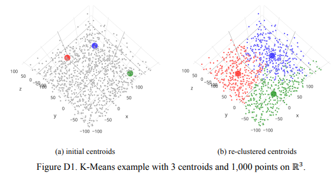
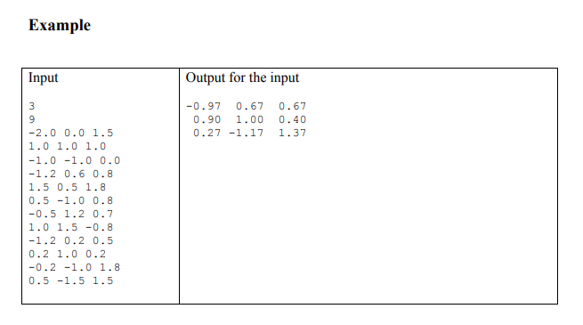

# K-Means Clustering

K-Means clustering is a method that allows the modeling of probability density functions by
the distribution of prototype vectors and is popular for cluster analysis in data mining. The
method will partition a set of n observations (points) into k clusters, where each point will be
associated with the cluster with the nearest mean. The Euclidean distance is usually the
adopted metric for proximity.

Clustering is a NP-hard problem, but there are efficient heuristic algorithms that can quickly
to a local optimum. In this implementation, the application takes as input the coordinates
(3D) of k initial centroids and a set of data points. K-Means performs an iterative process,
where points are re-clustered according to the minimum Euclidean distance between them
and the centroids. 

Next, the centroid of each partition is recalculated taking the mean of all
points in the partition, and the whole procedure is repeated until no centroid is changed and
no points are assigned to another cluster. Upon completion, the algorithm returns the
coordinates of the final k centroids.

### Input
The first two lines with contain the number of centroids k and the number of points n. The
next k+n lines will contain (x, y, z) coordinates for k centroids and n points, respectively.
The input must be read from the standard input

### Output
The program will print k lines containing (x, y, z) coordinates of the re-clustered k centroids.
The output must be written to the standard output.

## Criterios de avaliacao:

| Critério | Pontos |
| :--- | :---: |
| Modelagem e estratégia | 2,0 |
| Threads / OpenMP (memória compartilhada) | 2,5 |
| MPI (memória distribuída) | 2,5 |
| Análise de desempenho | 1,5 |
| Documentação | 1,5 |
| **Total** | **10,0** |
